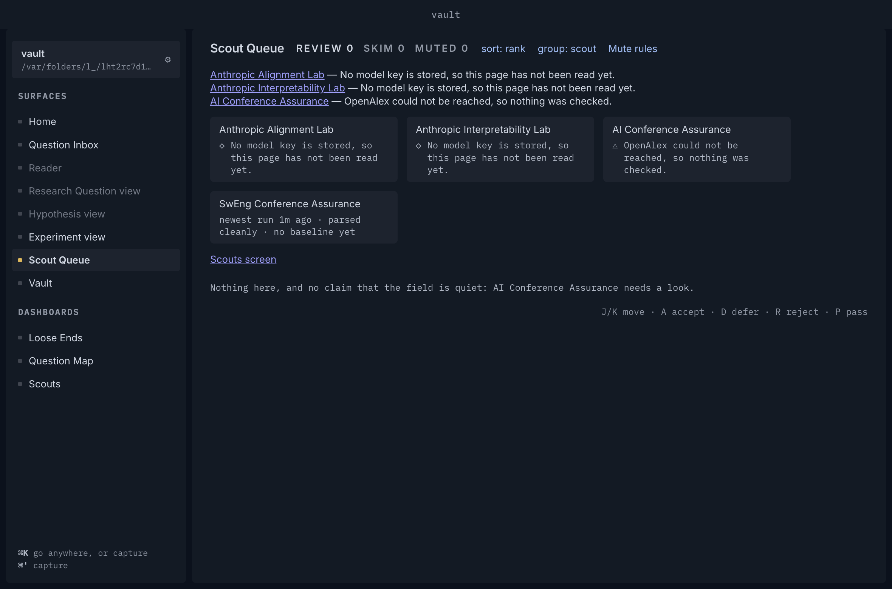
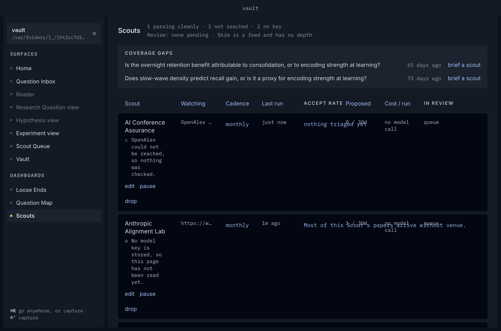
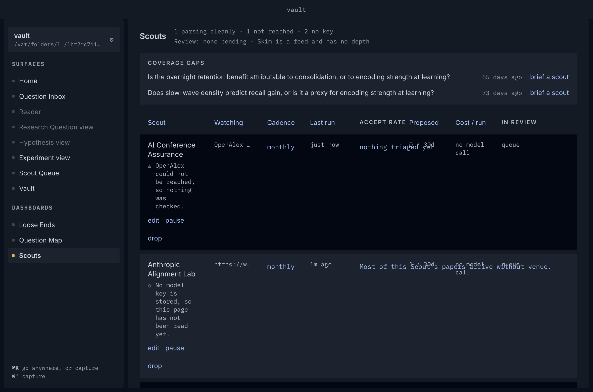
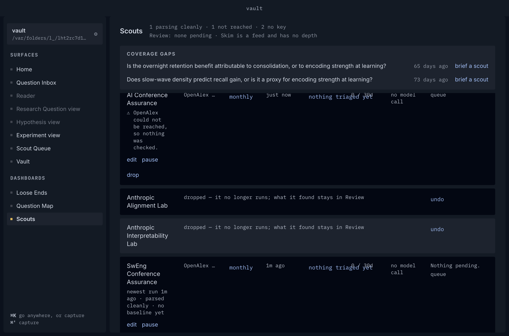
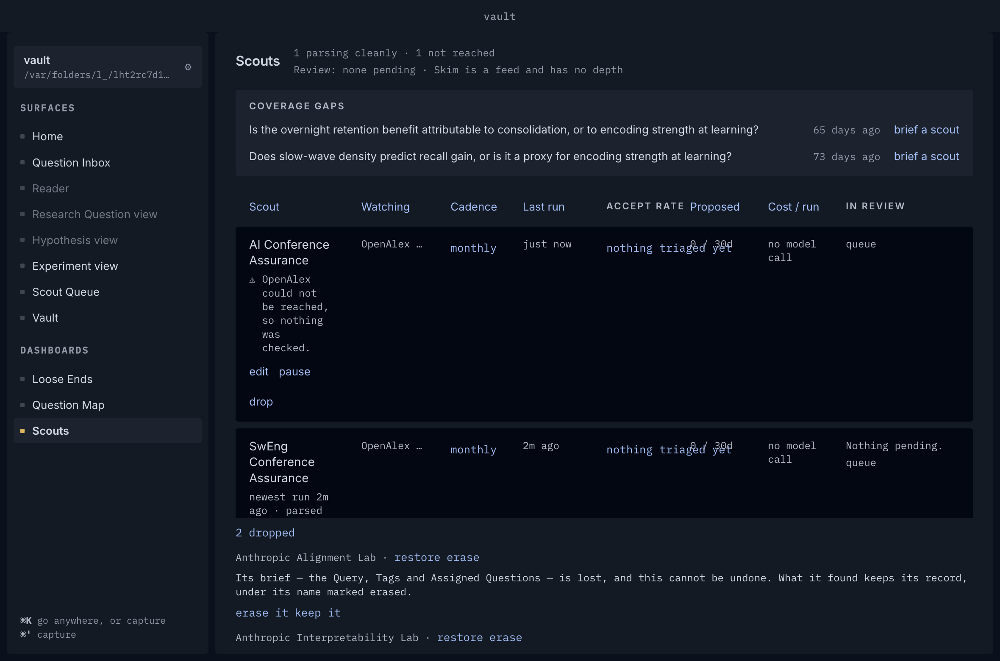
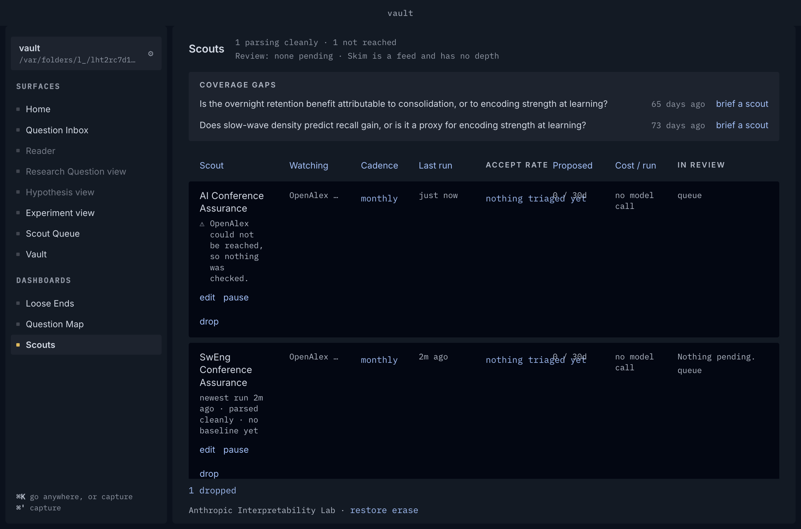
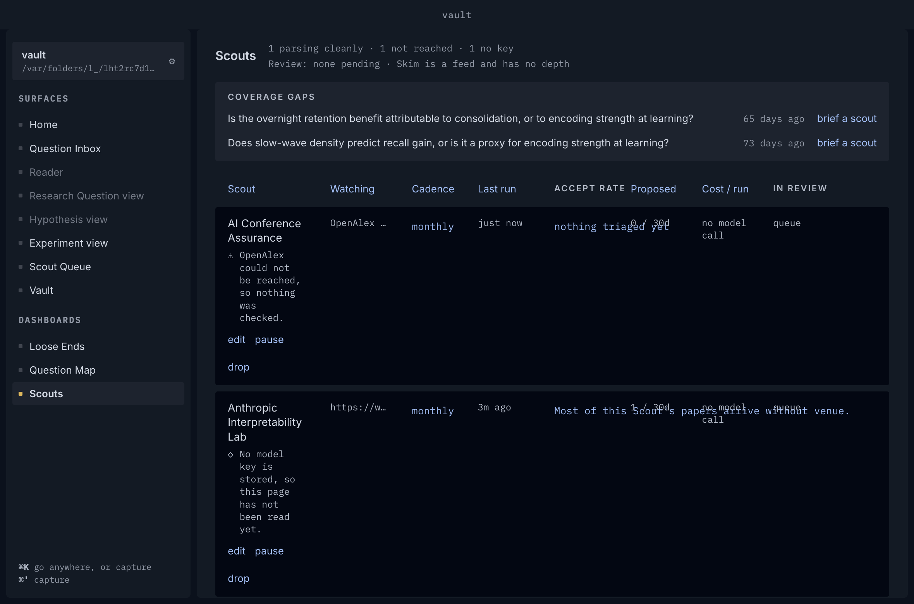
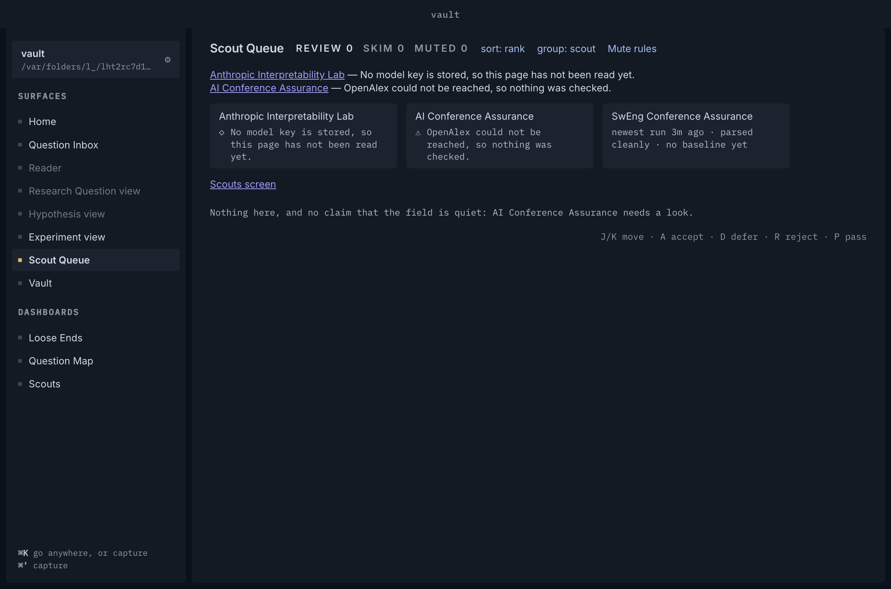

# Beat 15 record: the Scouts screen, drop, erase and restore against a real Scouts folder

Spec #854, beat #853, closing ticket #862. Produced by `node Scripts/scouts-screen-demo.mjs docs/records/beat-15`: four hidden launches on one scratch copy of the fixture vault plus a **snapshot** of the owner's real Scouts folder (four Scout files: two Watched pages, two OpenAlex), arXiv and OpenAlex on dead ports. The script fingerprints the real folder before and after and fails if it changed; each drive throws when the page does not show what its step claims, so these pictures are from a green run. All are dark, at the hidden window's default size.

| Step | Picture |
|---|---|
| 1. The Queue: papers only, a rail of Scout names with the marker beside each Scout that needs the researcher (◇ waiting on a key, ⚠ failed), a *Needs you* line naming each and linking to its row, and the permanent *Scouts screen* link. No Edit, Pause or Resume button. |  |
| 2. The link lands on the Scouts screen (`#/scout-management`). |  |
| 3. A marked Scout's line in the Queue lands on that Scout's row (`#/scout-management?scout=<id>`). |  |
| 4. Two Scouts dropped; each row keeps its place with *undo*. |  |
| 5. *erase* on the dropped line asks first, and says the brief is lost and cannot be undone. |  |
| 6. The first erased: no row, off the dropped line (*1 dropped*); a tombstone, `<id>.erased`, holds its name where its file was. |  |
| 7. The other restored beside the rest; the dropped line is gone. |  |
| 8. The Queue after: the rail has the restored Scout and not the erased one. |  |

The script also reads the files and the queue: both dropped files carry `dropped:`; the erased Scout's file is gone and its tombstone names it; the restored file carries no `dropped:`; and the two Scouts' runs, `triage`, `proposals` and `appearances` row counts are the same after drop, erase and restore as before (the failing Scout looks again at every launch, so its runs are left out of the count).

## Not shown here

- **A refused erase and a failed erase** need a Scout with Proposals waiting, or a write that fails; `scout-erase.test.ts` and `scout-activity.erase.test.tsx` hold them.
- **Tombstone resolution in a stub, a run line or Accept rate** needs a Scout whose Proposals were triaged; the core's `scout-tombstone.test.ts` reads each.

## Seen beside the pictures, not changed here

- On the Scouts screen the *Accept rate* column's `nothing triaged yet` overlaps the *Proposed* column's `0 / 30d` at this window width (steps 6 and 7). It predates this beat and breaks none of its behaviour.
