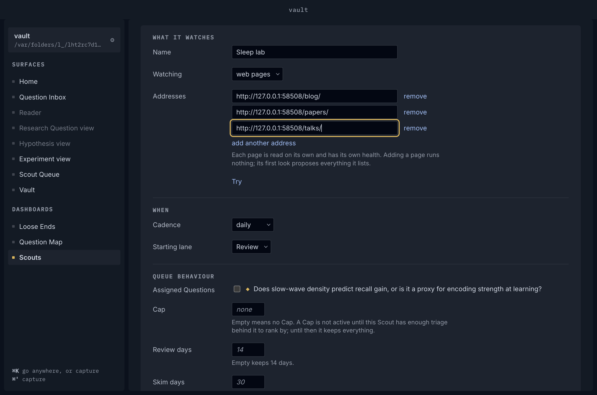
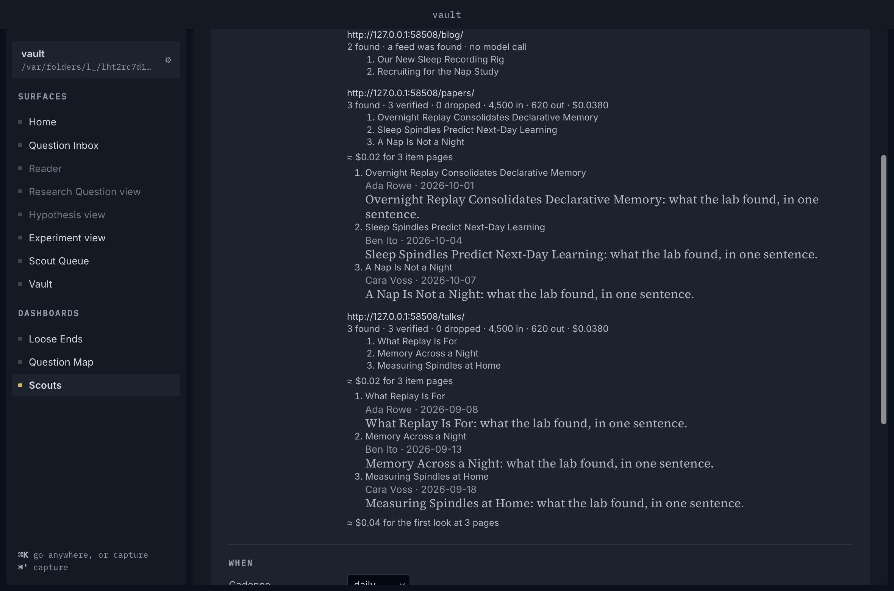
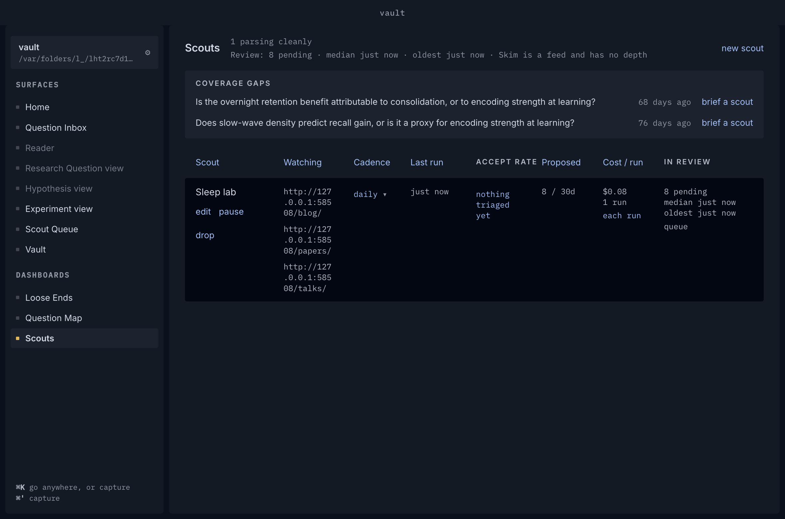
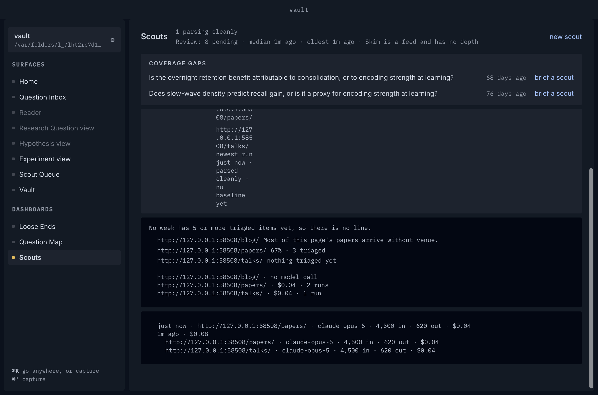
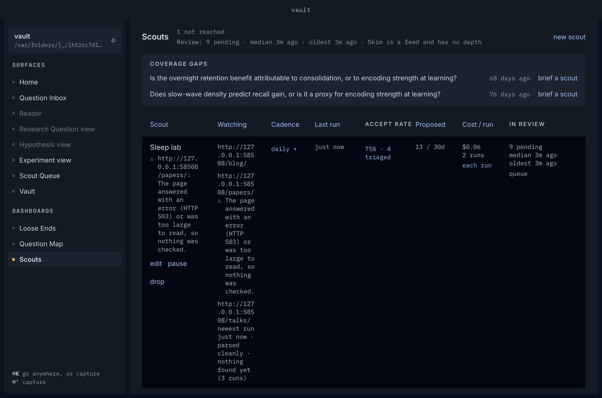
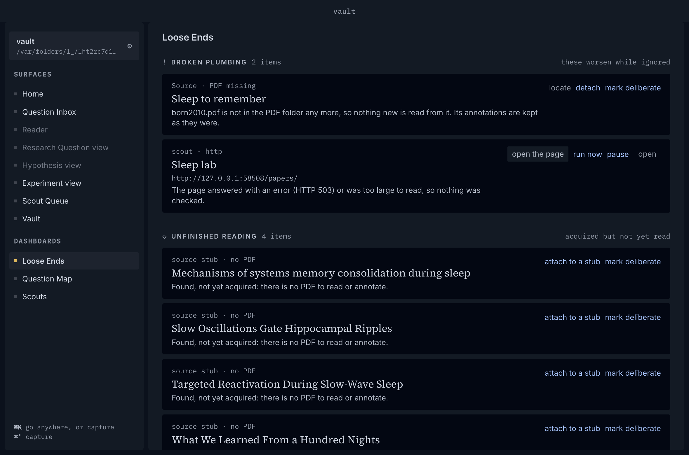
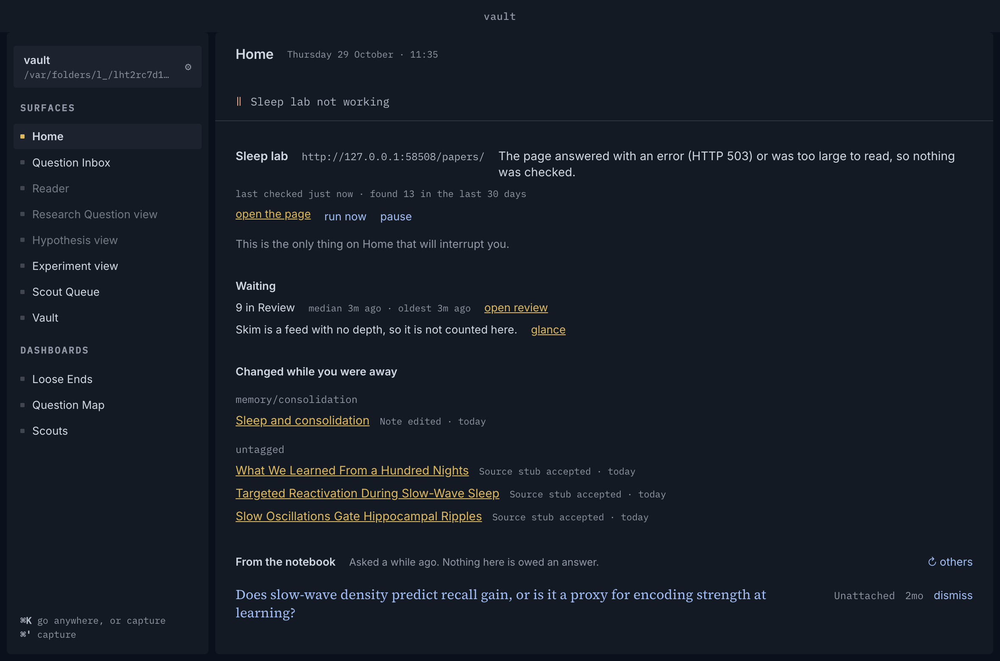
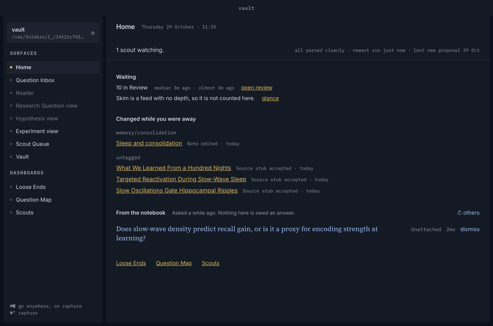
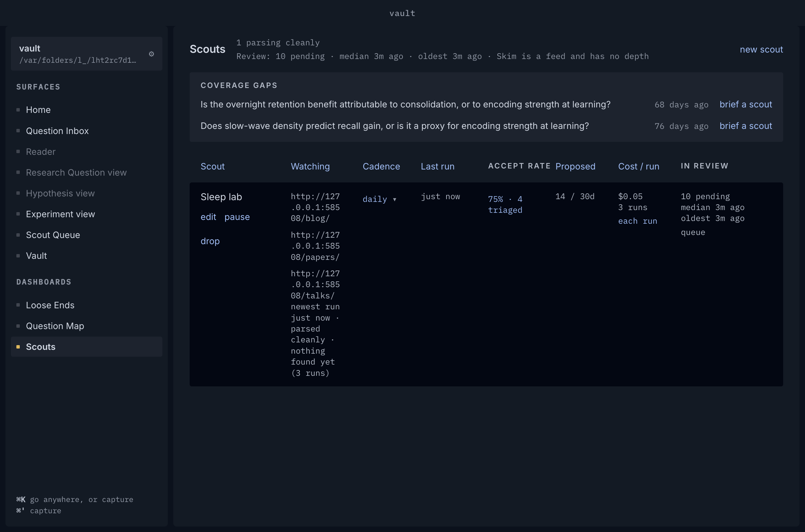

# Beat 16 record: one Scout, several pages

Spec #909, beat #906, ADR 0056, closing ticket #916. Produced by `node Scripts/several-pages-demo.mjs docs/records/beat-16`: three hidden launches on one scratch copy of the fixture vault, against a local stand-in for one lab's site and for the model's API (`Scripts/several-pages-demo/standin.mjs`) — never a real site or the real API. The Scout watches three pages on that site: `/blog/`, which advertises a feed; `/papers/`, which needs an Extraction and links each paper to an Item page; and `/talks/`, which needs an Extraction too and lists the same three talks at every check. The model's stand-in is reached through `demo-egress.mjs` and the key is kept in the core's memory (`docs/agents/run.md`). Each drive throws when the page does not show what its step claims, and the script reads the queue between launches, so these pictures are from a green run. All are dark, at the hidden window's default size. The stand-in's address is a different port on every run.

| Step | Picture |
|---|---|
| 1a. A new Scout on the form, its three pages added one *add another address* at a time. |  |
| 1b. *Try* answers each page under its address: the blog from its feed with no model call, the papers and talks pages by the model with their Item pages read, and the sum beneath, *≈ $0.04 for the first look at 3 pages*. |  |
| 2. Saved, then *Run now*: the first check reads all three, and the Scouts screen lists every page under *Watching* with nothing wrong on any. |  |
| 3. The second check: the blog and the papers page list new work and say nothing; the talks page lists what it did and reads as a Quiet field on its own line, *newest run just now · parsed cleanly · no baseline yet*. The Scout's own Voice, beside its name, carries no Warrant. |  |
| 4. Four new finds triaged in Review, then the row opened: the Accept rate by page (the blog's posts carry no venue, so its share is withheld on its own; the papers page *67% · 3 triaged*; the talks page *nothing triaged yet*), the cost per run by page, and *each run* listing the two checks, the older with its pages beneath. |  |
| 5a. The papers page answers 503 and *Run now* finds it: that page's line says so, the Scout's Voice names the page, and the blog and the talks page say what they said. |  |
| 5b. Loose Ends: one row, for the papers page, named under the Scout. |  |
| 5c. Home: the interrupt draws a line for the papers page, with *open the page*, *run now* and *pause*. |  |
| 6a. The site mended, *run now* on that line reads the papers page alone, and Home has let it go. |  |
| 6b. The Scouts screen after: every page well again. |  |

The script also reads the file and the queue: the saved file lists the three pages under `urls:`; each check is one row per page under one `check_id`; the second check found new work on the blog and the papers page and none on the talks page; the broken check failed only at the papers page; and the mending check is a single row, at the papers page, which found the paper the site put up while it was down. The stand-in was asked for robots.txt, the three pages, the feed, the Item pages and the model, and nothing else, and the egress log is empty.

## What the pictures showed, and what was done

- **Every page read `http://12…`.** The *Watching* cell cut each page's address at its end, which is the only part that tells pages on one host apart, so the quiet page's Warrant sat under an address that could have been any of the three. A page's address now wraps instead (`ScoutActivity.module.css`, `.pageUrl`); the opened row's breakdown, which uses the same class, wraps too. jsdom has no layout, so the pictures are the evidence.

## What diverged from the spec

- **Cost per run by page counts only runs that called a model.** The talks page's second look found its listing unchanged and made no call, so its line says *1 run* while it has been read twice. That is ADR 0056 decision 9 as built (a page's mean is over its runs that spent), and the Scout's own *cost / run* is over checks, so nothing is wrong; it is noted because the two counts read differently side by side.
- **The withheld page's sentence says *papers* of a blog's posts.** *Most of this page's papers arrive without venue.* is the Scout-wide sentence with *page* put in (ADR 0042 decision 3); whether an item is a paper or a post is never decided (`CONTEXT.md` § Watched source), so the word is the one the app has.

- **The quiet page's Warrant says *nothing found yet (3 runs)* at 5a and 6b**, though its first look proposed three talks. A first look is Retroactive, so its finds are the page's back catalogue and the baseline starts after it (`usualRate` in `scout-health.ts`); the talks page has found nothing new since, which is what the claim says.

## Not shown here

- **A key refused on one page of several** is the Scout's, said once on Home; `home-interrupt.test.tsx` holds it.
- **A page removed on the form** keeps its finds with the Scout and in the Accept rate's headline, and drops only its line from the breakdown; the core's `scout-pages.test.ts` holds it.

## Seen beside the pictures, not changed here

- **The *Watching* column is narrow at the hidden window's default width**, so a broken page's sentence, said once on its own line and again in the Scout's Voice beside the name (ADR 0056 decision 5, as designed), makes a tall row (5a). The row's width is the table's; how the Scouts screen spends it is a layout question for its own ticket.
