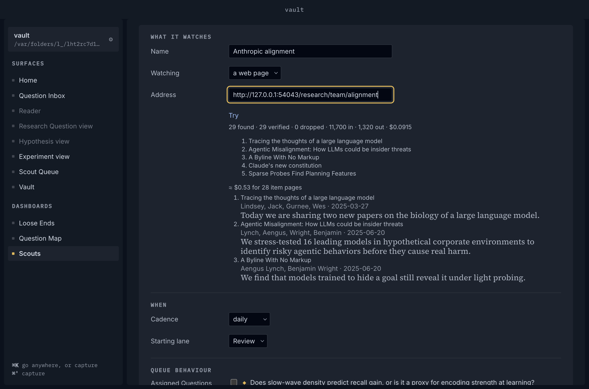
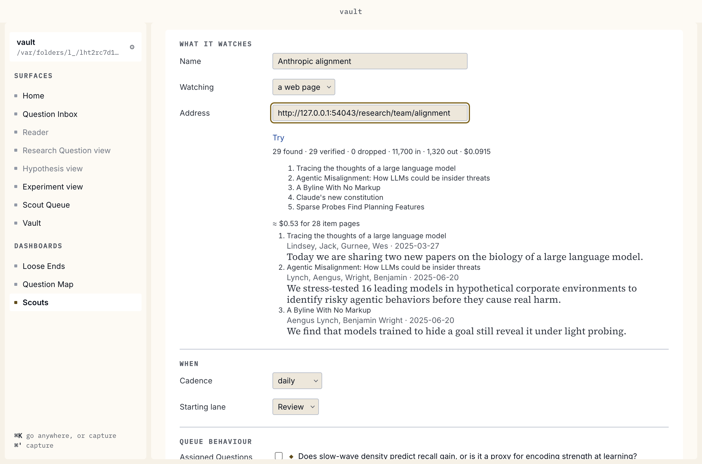
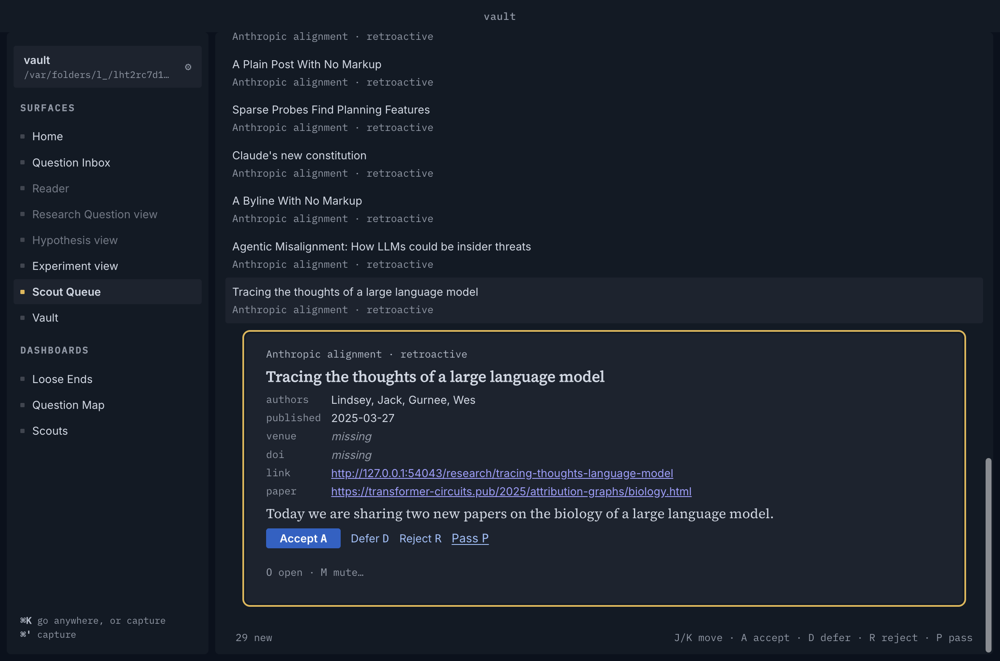
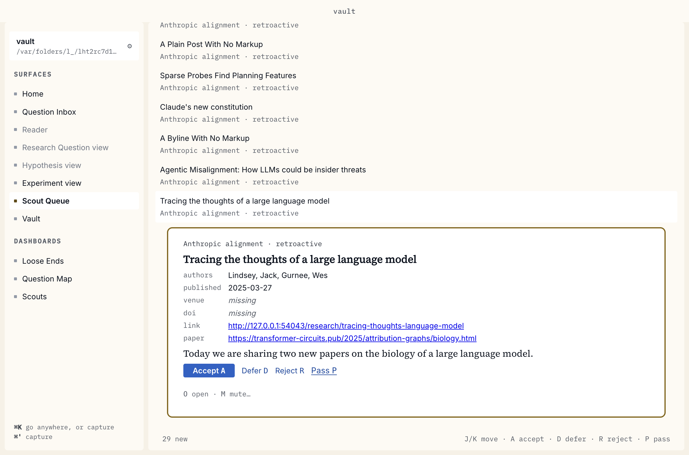
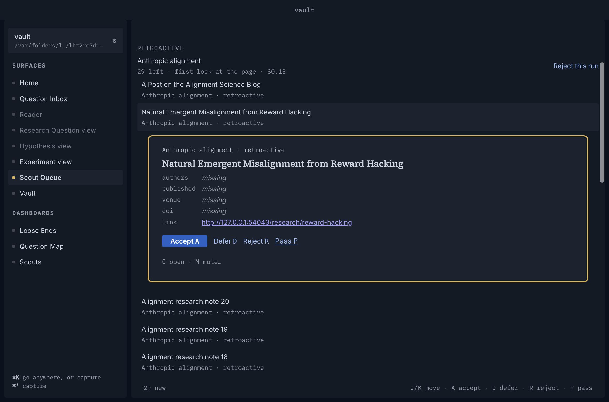
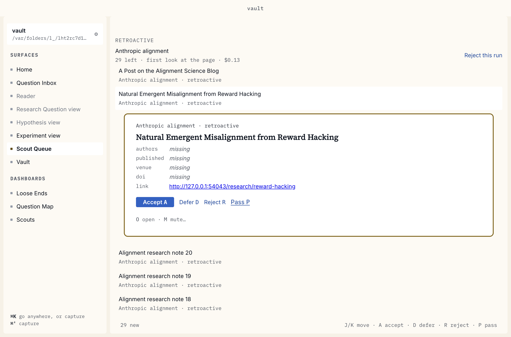
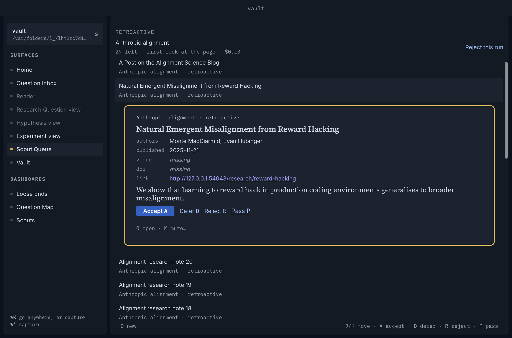
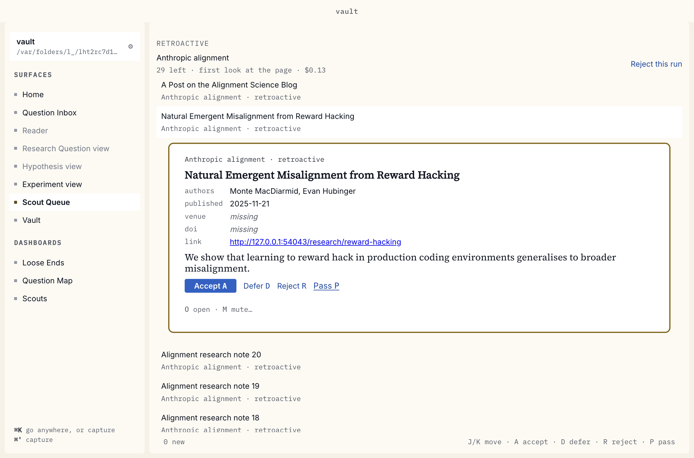

# Item pages record: the anthropic.com Scouts end to end

Spec #884, ADR 0055, closing ticket #892. Produced by `node Scripts/item-pages-demo.mjs docs/records/item-pages`: two hidden launches on one scratch copy of the fixture vault, against a local stand-in for anthropic.com's alignment listing, its Item pages (the core's recorded fixtures, the site's origin rewritten to the stand-in's, plus twenty generated notes so the listing passes the 25) and the model's API. Nothing is sent to the real site or the real API: the core's provider requests reach the stand-in through a demo-only preload under the pinned fetch (`docs/agents/run.md`), and the script fails if the core's `fetch`, which is all its egress, asked for anything off the machine. The shell and the renderer are not wrapped. Each drive throws when the page does not show what its step claims, so these pictures are from a green run.

| Step | Dark | Light |
|---|---|---|
| 1. *Try* on the listing: three Item pages read, *≈ $0.53 for 28 item pages*, and the cards they filled |  |  |
| 2. The first look's card for an item whose page names its paper: date, summary, authors, *paper* beside *link* |  |  |
| 3a. The last item on the listing's site, past the 25: Listing-only, its fields *missing* |  |  |
| 3b. The same card after the next run, on an unchanged listing: filled from its page's declared metadata |  |  |

The script also reads the queue and the vault: the first look is an `ok` run with 25 Item pages read and none unread, three cards are left with `item_page_tries` 0, and the off-host item is owed nothing; the next run reads those three; the accepted card's stub has `paper:` right after `url:`, which is still the Item page. The stand-in saw robots.txt, the listing, its Item pages and the model, and nothing else, so no link on an Item page was followed.

## What the pictures showed, and what was done

- **An undated card said nothing.** A Listing-only card's date is `''`, not null, so the Queue drew *published* as an empty line where every other empty field says *missing*. It now says *missing* (`scout-queue.review.test.tsx`).

## Mutation tables, rerun against the merged code

Each mutant was applied to a scratch `git archive` export of `main` at `10e69505`, the Item-page suites were run (`item-pages`, `item-pages-unread`, `listing-only`, `paper-link`, `loose-ends`, `watched`, `scout-form` and the v14–v17 migrations in the core; `scout-queue*` and `scout-form` in the renderer), then the export was restored. A survivor was run again against the whole core suite. *Caught by* names the tests that failed; "same" means the result matches what the ticket's PR recorded.

### #886, Verify (PR #895): 21 of 23 caught, 2 survive by design, as recorded

PR #895's prose says 19 of 20; its table, which this follows, has 23 rows with the two survivors.

| Mutant | Caught by now | Same? |
|---|---|---|
| **Accept an unverified value** | made-up author · script-hidden name · date not on the page · past the cut · Listing-only *Verified* · Paper link not on the page | same, plus two later tests |
| Verify against raw HTML | script-hidden name · past the cut | same |
| Verify against the uncut text | past the cut | same |
| No whitespace collapse on the page | date checked as written | same |
| Authors all-or-nothing | made-up author · past the cut · Listing-only *Verified* | same, plus one |
| Dropped value not counted | made-up author · script-hidden name · date not on the page · Listing-only · Paper link | same, plus two |
| Date not formatted | date checked as written · *try*'s three cards | same, plus one |
| Calendar not checked | Feb 31 kept as copied | same |
| Venue alone makes a call | asks only for what is empty · spend summed · two *try* tests | same, plus two |
| No budget cut | past the cut | same |
| Item-page spend not summed | spend summed · Listing-only *Verified* | same, plus one |
| Failed call's spend not summed | model cannot read it | same |
| Model error fails the run | model cannot read it (new item and Listing-only) · not the model's failure (50 %) · *try* measures a failed page | same, plus three |
| Model error not a try | model cannot read it · not the model's failure | same, plus one |
| Model error counted as read | model cannot read it · not the model's failure | same, plus one |
| Rejected key swallowed as a try | key rejected on an Item page | same |
| Copied organisation passed as a person | organisation copied by the model | same |
| A field not asked for is taken | never replaces what the page declared | same |
| Both fill guards broken: a set field filled | never replaces what the page declared · asks only for what is empty · two Listing-only | same, plus three |
| Copy-side fill guard alone | **survives by design** (the whole suite once failed `byok.leak`, which passed three reruns alone: load, not the mutant) | same |
| Listing-only: model failure clears the try | model cannot read it (Listing-only), at the read and at the write | same |
| Listing-only: the row's venue ignored when asking | asked only for what its row still lacks | same |
| Listing-only: write-time `venue` guard becomes `COALESCE` | **survives by design**, whole suite too | same |

### #887, Listing-only (PR #894): 13 of 13 caught, with the write-time guard split out and surviving by design

The first two rows were one mutant each in PR #894, written when the fill had one guard, at the write. #886 then put the same rule on the read (`filled`, shared with new items), so the rerun breaks each side apart: the read side alone and both together are caught, and the write side alone survives the whole suite, as #886's write-time `venue` guard does. *gains only the fields it lacks* now fails only with both broken. No test lost a mutant it once caught: the mutant it caught is the both-sides one.

| Mutant | Caught by now | Same? |
|---|---|---|
| fill a set `published` / `authors` | read side broken: *fills only what the listing left empty* · feed *never overwrites*; both sides: those and *gains only the fields it lacks* | differs: *gains only…* needs both guards broken. The write-time guard alone survives (whole suite too), since the read already kept the field |
| fill a set `abstract` / `doi` | read side: feed *never overwrites*; both: that and *keeps an abstract and a DOI* | differs in the same way; write-time alone survives by design |
| **fill a triaged card** (the write's `state = 'pending'` dropped) | not written when triaged while its page is being read | same |
| read a triaged card (the selection's pending filter dropped) | not read, nor changed, once accepted, rejected or deferred | same |
| page-unchanged short-circuit skips Item pages | 14 tests, incl. the 25 + three test | same, more tests since |
| newest first | oldest-first test + 3 others | same |
| Listing-only ignores the 25 | read no more than the 25 allow | same |
| read another Scout's cards | read by its own Scout's runs, never another's | same |
| no site check (re-pointed Scout) | not read once its Scout is pointed at another site | same |
| a read doesn't clear the debt | 7 tests | same, more tests since |
| a failed read adds no try / clears the debt | stays owed with the try counted · tried three times in all (+ retried counted unread) | same, plus #888's |
| migration: any state / any host / `www.` not ignored | `queue.migration.v14.test.ts` (+ the end-to-end backfill test for any host) | same |
| renderer: no re-read on `scoutFinished` | `scout-queue.fill-in.test.tsx` | same |

### #888, retries and the 50 % rule (PR #896): 18 of 18 caught

| Mutant | Caught by now | Same? |
|---|---|---|
| 50 %: `<` → `<=` | exactly half is clean, + 6 | same |
| 50 %: fault on any unread page | one card of ten · exactly half · refusing site with a Listing-only first read | same |
| 50 %: fault only when none read | one page of three read · refusing site… | same |
| 50 %: never fault | 6 tests | same |
| 50 %: retries counted | one dead link retried alone breaks nothing | same |
| 50 %: Listing-only first reads not counted | refusing site when a Listing-only card's first read fails too | same |
| Loose Ends exclusion dropped | the generic failed-Scout row… | same |
| Loose Ends excludes the wrong message | the generic failed-Scout row… | same |
| tries cap 4 | tried three times in all, and never a fourth | same |
| tries uncapped | tried three times in all, and never a fourth | same |
| unread not counted | 5 tests | same, plus *try*'s count |
| faulted run proposes nothing | 4 tests | same |
| faulted run returns deferrals | not the clean run a deferral waits for | same |
| unread run not a first look | does not make the next run's finds Retroactive | same |
| unread run doesn't vouch for the hash | vouches for its listing… | same |
| generic sentence | Home/Activity and Loose Ends tests, whole suite too | same |
| model-unread page counted toward the 50 % | not one whose pages the model could not read · #886's two *model cannot read it* | same |
| model-unread page counted unread | not one whose pages the model could not read · *try* says how many could not be fetched | same, plus one |

### #889, the Feed path (PR #900): 5 of 5 caught

| Mutant | Caught by now | Same? |
|---|---|---|
| **Feed path given a real reader**, so it reaches the Item-page Extraction | *makes no model call of either kind…* (both) · the fills tests · 2 feed tests in `watched.test.ts` | same |
| Feed's Item pages skipped | 7 tests, including the fills and no-overwrite tests | same |
| Declared metadata overwrites an entry's author | *never overwrites what the entry itself said…* · *fills only what the listing left empty* | same |
| Listing-only backlog skipped for a feed | *drains the Scout's Listing-only cards…* | same |
| Backlog read marked unread for a feed | *drains the Scout's Listing-only cards…* | same |

### #890, the Paper link (PR #899): 8 of 9 caught, 1 survives by design, as recorded

| Mutant | Caught by now | Same? |
|---|---|---|
| **`heldIn` reads `paper:` as a key** | *holds nothing: the paper itself, found by an arXiv Scout, is proposed though a stub names it as `paper:`* | same |
| `paperUrl` not Verified | *drops a Paper link that is not on the page* | same |
| `paperUrl` never asked for | 7 tests (paper-link, item-pages, listing-only) | same |
| Paper link replaces the link back | 2 paper-link tests | differs: PR #899 names neither where its mutant sat nor its four tests; this one swaps the card's `url` for the Paper link where the row becomes a `Card` |
| stub omits `paper:` | *writes `paper:` after `url:`* | same |
| Listing-only fill drops `paper_url` | listing-only *…asked for the fields its row lacks, and Verified* | same |
| Queue hides *paper* | renderer *shows the Paper link beside the link back* | same |
| Queue swaps *paper* for the link back | renderer *shows the Paper link beside the link back* | same (recorded with the row above) |
| a copy overwrites a set Paper link | **survives, by design**: a card that has one is never asked again, and the write's `COALESCE` keeps it, whole suite too | same |
