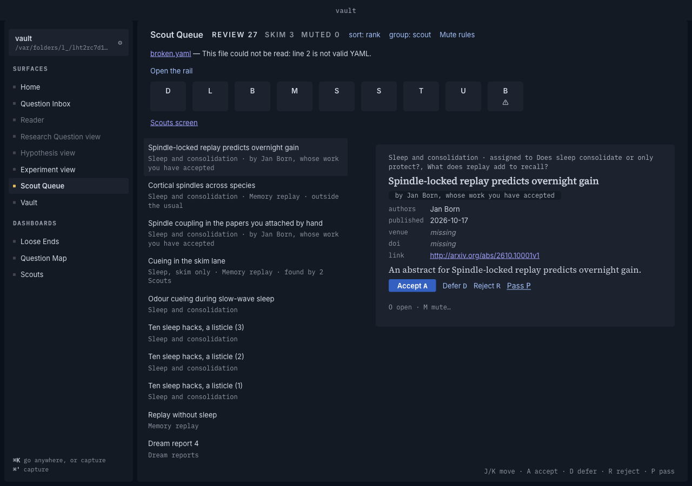
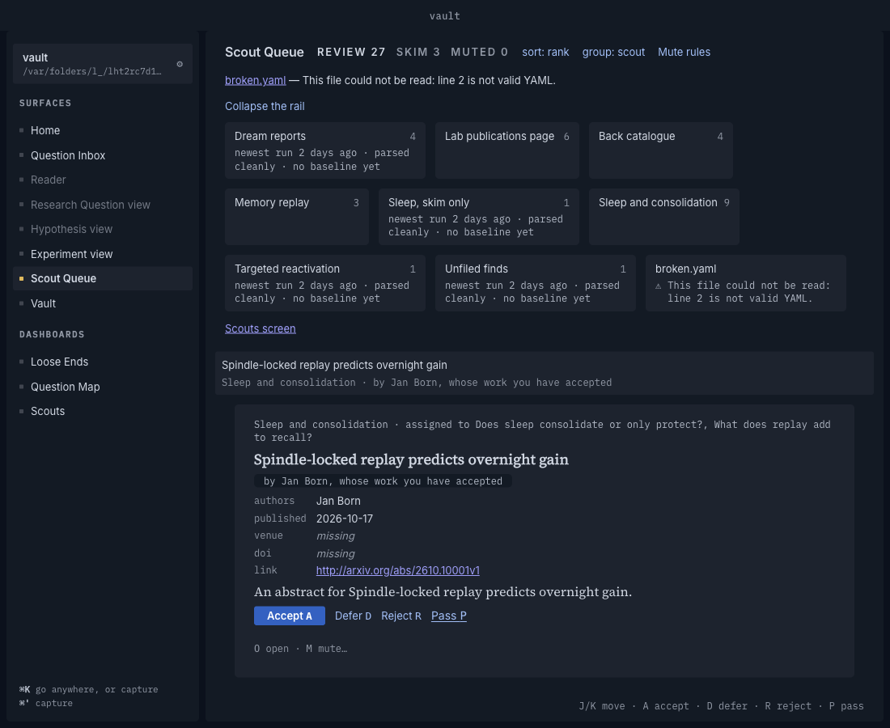
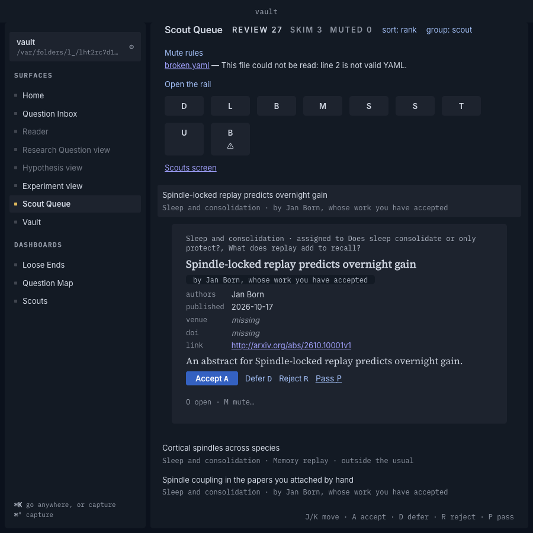

# The Queue's layout at 1280px, and the mutation table

Spec #867, beat #853, closing ticket #871. Produced by `node Scripts/queue-layout-demo.mjs docs/records/queue-layout`: one hidden launch on beat 14's scratch vault (nine Scouts, one file that does not parse), against beat 6b's arXiv stand-in. The drive throws when the abstract's line at 1280px is outside 55–85 characters, when the layout does not cross where `WIDE_FROM` (960px of the Queue's own width) says, or when a stacked Queue still has a detail pane, so these pictures are from a green run. `measurements.json` holds every number below.

| Window | Picture |
|---|---|
| 1280px, sidebar open, rail collapsed |  |
| 1100px, rail open (stacked) |  |
| 900px, rail collapsed (stacked, the paper opens in its row) |  |

## What was measured

The abstract's measure is the characters its width holds in its own font (the fixture's abstracts fit one line).

| Window | Layout | Queue | Rail height | List | Detail | Abstract |
|---|---|---|---|---|---|---|
| 1280, rail open | wide | 1018 | 246 | 401 | 601 | ~65 chars |
| 1280, rail collapsed | wide | 1018 | 67 | 401 | 601 | ~65 chars |
| 1230, rail collapsed | wide | 968 | 67 | 381 | 571 | ~61 chars |
| 1220, rail collapsed | narrow | 958 | 67 | 958 | none | ~108 chars |
| 1100, rail collapsed / open | narrow | 838 | 67 / 246 | 838 | none | ~93 chars |
| 900, rail collapsed | narrow | 638 | 113 | 638 | none | ~67 chars |

- **The abstract keeps a readable line.** About 65 characters at 1280px with the rail collapsed, 61 at the edge of the wide layout.
- **The rail costs height, not width.** It is a row above the panes, so collapsing it gives back 179px of height at 1280px and changes neither pane's width. It does not collapse by itself; `[` and its button do.
- **The Queue crosses 960px between a 1220px and a 1230px window** (sidebar and gutters take 262px).
- **Stacked, a 900px window's rail wraps to two rows (113px) even collapsed**, the point at which the strip stops fitting on one row.

## The mutation table

Each rule broken in the code that enforces it, on a scratch export of the branch, with the `scout-queue.*` suite run for each. All twelve mutants were caught; none survived.

| # | Rule | Mutant | Caught by (the test that names the rule) | Failing |
|---|---|---|---|---|
| M1 | Exactly one row is open (Review) | `stacked && current` → `stacked` in `ScoutQueue.tsx` | `scout-queue.expand` › *opens exactly one row as J and K move it* | 13 |
| M2 | Exactly one row is open (Skim) | `stacked && l === line` → `stacked` | `scout-queue.expand` › *opens the Skim line chosen in its row too* | 1 |
| M3 | Wide opens nothing in the list | `stacked && current` → `current` | `scout-queue.expand` › *wide: nothing opens in the list* | 100 |
| M4 | Stacked, no separate pane exists | `!stacked &&` → `true &&` on the Review detail pane | `scout-queue.expand` › *holds the detail in the chosen row, with no separate pane* | 12 |
| M5 | The threshold reads the Queue's width, not the window's | `width >=` → `window.innerWidth >=` in `queue-width.ts` | `scout-queue.layout` › *follows the Queue's width at one window size* | 9 |
| M6 | The threshold is 960px, inclusive | `>=` → `>` | `scout-queue.layout` › *follows the Queue's width…* (the one test that sets the width to 960) | 1 |
| M7 | Crossing the threshold keeps the paper chosen | reset the choice when `layout` changes | `scout-queue.layout` › *keeps the same paper chosen when the Queue crosses* and `scout-queue.expand` › *keeps the same paper open when the Queue crosses* | 2 |
| M8 | The marker is on the collapsed rail | drop `{marker}` from the strip's entry | `scout-queue.collapsed-rail` › *shows a marker for a wrong or credential-blocked Scout and for no other* (and three more) | 4 |
| M9 | The collapsed rail still filters | no `onClick` when collapsed | `scout-queue.collapsed-rail` › *filters from the strip, and clearing restores the list* | 1 |
| M10 | Each strip button is named for a screen reader | drop the `srOnly` name | `scout-queue.collapsed-rail` › *names every button for a screen reader* (and three more) | 4 |
| M11 | The markers stay under Group by Question | no marker when `groupBy === "question"` | `scout-queue.collapsed-rail` › *keeps the markers under Group by Question* | 1 |
| M12 | The rail's button says whether it is open | drop `aria-expanded` | `scout-queue.collapsed-rail` › *announces whether it is open on a button the keyboard reaches* | 1 |

M3, M4 and M5 fail many tests because a second detail, a pane that should not exist or a layout that follows the window breaks every test that counts rows or panes; the named one is the test that exists for the rule.

## Not shown

- The Queue's J/K, A/D/R/P and chosen-in-view behaviour in either layout are the jsdom tests' (`scout-queue.expand`, ADR 0030); a hidden launch measures space, not keys.
- The rail yielding "first" is a measure of cost, not an automatic behaviour: nothing collapses it as the window narrows. That is as ADR 0054 decision 4 has it (a key and a hover), but ADR 0054 decision 5's wording could be read as a window-driven collapse.
